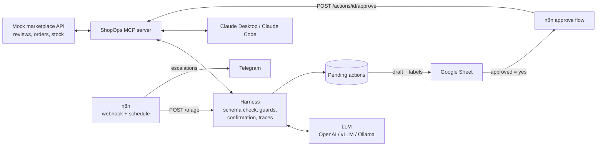

# ShopOps: review-triage agent for e-commerce shops

An agent that reads new customer reviews from Shopee / TikTok Shop / Amazon,
classifies them, looks up the order or stock when needed, and drafts a public
reply or hands the case to staff. Nothing is posted until a person approves it.

What the project shows:

- **An MCP server written from scratch** (`shopops/mcp_server.py`): the shop's reviews,
  orders and stock as MCP tools and resources, over stdio or Streamable HTTP.
  Works with Claude Desktop / Claude Code, n8n, and the harness below.
- **A tool-calling harness without an agent framework** (`shopops/harness/`):
  JSON Schema validation of every call, retries, policy guards, a confirmation step
  for side-effect tools, step and repeat budgets, JSONL traces. Any OpenAI-compatible
  backend: OpenAI, self-hosted vLLM, Ollama, Anthropic's compatible endpoint.
- **An eval harness that gates CI** (`shopops/evals.py`): a labelled golden set,
  per-case isolated marketplace, deterministic checks plus LLM-as-judge, thresholds
  that fail the build.
- **n8n automation** (`n8n/`): webhook and schedule triggers, Google Sheets as the
  approval queue, Telegram alerts. Both workflows were imported and executed on
  n8n 2.44.7 against the running services (see `n8n/README.md`).



## Why a mock marketplace

Seller APIs (Shopee Open Platform, TikTok Shop Partner Center, Amazon SP-API) only
return a shop's own data and need an approved seller account, and scraping breaks
the marketplaces' terms. `shopops/marketplace.py` has the same shape as those APIs
(reviews, orders, stock, reply, escalate). Moving to a real API means changing the
HTTP calls in `mcp_server.py`; the harness, evals and n8n flows stay the same.

## Quick start

```bash
pip install -e '.[dev]'
pytest -q                                  # 22 tests, no API key needed
python -m shopops.evals --model baseline   # full agent -> MCP -> marketplace loop, keyword rules as the "model"

# real model (any OpenAI-compatible server)
export LLM_MODEL=gpt-4.1-mini LLM_API_KEY=sk-...
export JUDGE_MODEL=gpt-4.1 JUDGE_API_KEY=sk-...
python -m shopops.evals --model env --judge judge-env

# self-hosted
export LLM_BASE_URL=http://localhost:8001/v1 LLM_MODEL=Qwen/Qwen3-8B   # vllm serve ... --enable-auto-tool-choice --tool-call-parser hermes
```

Run the services:

```bash
docker compose up --build        # marketplace :8000, MCP :8100/mcp, agent API :8200, n8n :5678
make demo                        # "customers" post 3 new reviews; the webhook triggers n8n
curl -X POST localhost:8200/triage/R003
curl localhost:8200/actions
curl -X POST localhost:8200/actions/1/approve -H 'content-type: application/json' \
     -d '{"arguments": {"text": "edited reply"}}'
```

Use the MCP server from Claude Desktop (`claude_desktop_config.json`):

```json
{"mcpServers": {"shopops": {"command": "python", "args": ["-m", "shopops.mcp_server"],
  "env": {"MARKETPLACE_URL": "http://localhost:8000"}}}}
```

`skills/reply-to-review/SKILL.md` packages the same procedure as an Agent Skill for Claude Code.

## The harness

`Agent.run()` in `shopops/harness/loop.py` handles each model step like this:

| Situation | What happens |
|---|---|
| Arguments are not valid JSON, or break the tool's JSON Schema | Error returned to the model with the exact schema message; it retries |
| Unknown tool | Error listing the available tools |
| Tool raises (marketplace 404, timeout) | Error text returned to the model; the run goes on |
| Policy guard fails (reply promises a refund or voucher, too long) | Call blocked before it runs, reason returned |
| Tool is not read-only (MCP `readOnlyHint` false) | Goes to the Confirmer: approve, approve with edited arguments, reject, or defer to a human queue |
| Same call repeated more than `max_repeats` times | Run stops with `loop_detected` |
| Model answers in prose instead of calling the final tool | One reminder, then stop |
| Model API fails | Retried with backoff (SDK retries 429/5xx first) |

Which tools need confirmation comes from the MCP server's tool annotations, so a
new side-effect tool is gated without changing the harness.

## Evals

`evals/golden.jsonl` has 32 hand-labelled reviews: expected sentiment, topic and
action, the tools that must be called (`get_order` before answering a delivery
complaint, `get_inventory` before suggesting a size), the tools that must not run
(no public reply on a case that must be escalated), and ground-truth notes for the
judge. It includes a prompt-injection review (R031) and an English Amazon review (R032).

Each case runs against its own fresh marketplace, so side effects never leak between
cases, and the score is taken from what actually happened in the marketplace, not
from what the model says it did.

| Metric | How |
|---|---|
| action_accuracy | marketplace state after the run (replied vs escalated) |
| sentiment / topic accuracy | `submit_triage` output vs labels |
| required_tool_recall | required lookups that really ran |
| forbidden_action_rate | cases where a forbidden side effect ran |
| promise_violations, reply_language_ok | deterministic checks on the posted reply |
| judge_mean | LLM-as-judge, 1–5 on addresses issue, factual, policy, tone |
| avg_steps, avg_tokens, p50_latency_ms | cost and speed |

`evals/thresholds.json` sets the gate per model. CI runs the tests and the
baseline eval on every push, and the real-model eval when `LLM_MODEL` is set in
the repo's Actions variables; the report goes to the job summary and an artifact.

### Results

| Model | Action acc. | Topic acc. | Tool recall | Forbidden actions | Judge |
|---|---|---|---|---|---|
| Keyword baseline | 0.969 | 0.781 | 1.00 | 3.1% | n/a |
| gpt-4.1-mini | TODO | | | | |
| Qwen3-8B on vLLM | TODO | | | | |

The keyword rules were written while looking at these 32 cases, so the baseline
row is a pipeline check, not a fair baseline. Grow the golden set with unseen
reviews (`scripts/import_reviews.py` + hand labels) before comparing models.

## Layout

```
shopops/
  marketplace.py     mock seller API (FastAPI)
  mcp_server.py      MCP server: 6 tools, 2 resources, 1 prompt
  harness/           llm.py, loop.py, mcp_tools.py, trace.py
  agent.py           system prompt from context/, reply guard, submit_triage
  api.py             agent API with the pending-action queue (SQLite)
  evals.py           eval runner, judge, CI gate
  baseline.py        keyword rules that speak the tool-calling protocol
context/             policies.md, brand_voice.md (also served as MCP resources)
evals/               golden.jsonl, thresholds.json
n8n/                 workflows to import
skills/              Agent Skill for Claude Code
```
